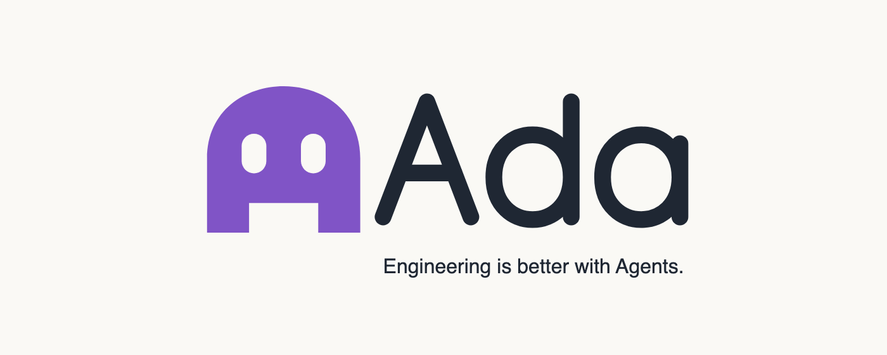

<p align="center">
  <picture>
    <source media="(prefers-color-scheme: dark)" srcset="assets/agents/pip-lockup-dark.png">
    <source media="(prefers-color-scheme: light)" srcset="assets/agents/pip-lockup-light.png">
    
  </picture>
</p>

<p align="center">
  <a href="https://x.com/jayleaton"></a> <a href="https://buymeacoffee.com/jayleaton"></a>
</p>

Ada (Agentic Desktop Application) lets you direct the coding agents on your machine (Claude Code, Codex, Cursor, Grok Build,
OpenCode, Google Antigravity, and fx) from one workspace, across a desktop app, a web app, and a
mobile app. Your agents run wherever Ada runs: your desktop, a server, or a VPS, and you can connect
to it from anywhere.

## Installation

> [!WARNING]
> Ada currently supports Codex, Claude, Cursor, Grok Build, OpenCode, Antigravity, and fx. Install and authenticate at least one provider before use:
>
> - Codex: install [Codex CLI](https://developers.openai.com/codex/cli) and run `codex login`
> - Claude: install [Claude Code](https://claude.com/product/claude-code) and run `claude auth login`
> - Cursor: install [Cursor CLI](https://cursor.com/cli) and run `agent login`
> - Grok Build: install [Grok Build CLI](https://x.ai/cli) and run `grok login`
> - OpenCode: install [OpenCode](https://opencode.ai) and run `opencode auth login`
> - Antigravity: enable it in Settings, then use **Install Antigravity** and **Sign in with Google**. No CLI is required.
> - fx: install [fx](https://fx.sh) and run `fx login` on the machine running the Ada server ([setup guide](./docs/user/providers-fx.md))

### Desktop app

Download Ada from [GitHub Releases](https://github.com/jayleaton/ada/releases): the `.dmg` on macOS, the `.exe` on Windows, or the `.AppImage` or `.deb` on Linux. Its updater then follows nightly releases; there is no Stable track yet.

`winget`, Homebrew, the AUR, Nix and `npx t3` install T3 Code, not Ada.

### Command line

The desktop app includes the `ada` command (**Settings → About → ada command**). `ada update` and `ada service install` download Ada's releases. For a Linux machine without a desktop, see [Headless Linux host](./docs/operations/headless-linux.md).

### Switching from T3 Code

Ada uses the same data directory (`~/.t3`), so your projects, threads, settings, provider sign-ins and paired devices carry over, and phones and other machines still recognise this one. Your database is upgraded the first time Ada starts.

- Quit T3 Code first. The two apps share one profile, so only one of them can run at a time.
- If you installed T3 Code's background service, run `t3 service uninstall` before opening Ada. Otherwise that service keeps using your data directory and Ada cannot start its own server.
- Ada does not include T3 Connect. Devices you paired through T3 Connect need to pair again over your local network or tailnet ([remote access](./docs/user/remote-access.md)).

## Some notes

We are very very early in this project. Expect bugs.

We are (mostly) not accepting contributions yet. Small fixes may be considered. Big features will not be.

## Documentation

Full docs live in [docs/](./docs). There's no docs site yet.

- [FAQ](./docs/user/faq.md)
- [Install and first run](./docs/user/install.md)
- [Permission modes](./docs/user/permission-modes.md)
- [Keyboard shortcuts](./docs/user/keybindings.md)
- [Project settings](./docs/user/project-settings.md)
- [Appearance preferences](./docs/user/appearance.md)
- [Remote access from a phone or another machine](./docs/user/remote-access.md)
- [Connect Claude Code, Codex, ChatGPT and other agents over MCP](./docs/user/outside-agents.md)
- [Keeping app and server in sync](./docs/user/updating.md)
- [Source control integrations](./docs/user/source-control.md)
- Multiple accounts: [Codex](./docs/user/providers-codex.md) · [Claude](./docs/user/providers-claude.md)
- [Run Ada as a background service](./docs/user/background-service.md)

Building from source? Start at [docs/internals/overview.md](./docs/internals/overview.md).

## If you REALLY want to contribute still.... read this first

### Install `vp`

Ada uses Vite+ so you'll need to install the global `vp` command-line tool.

#### macOS / Linux

```bash
curl -fsSL https://vite.plus | bash
```

#### Windows

```bash
irm https://vite.plus/ps1 | iex
```

Checkout their getting started guide for more information: https://viteplus.dev/guide/

### Install dependencies

```bash
vp i
```

Read [CONTRIBUTING.md](./CONTRIBUTING.md) before reporting a bug or opening a PR.

Have a feature request? Start a [discussion](https://github.com/jayleaton/ada/discussions).

Found a bug? Open an [issue](https://github.com/jayleaton/ada/issues).
